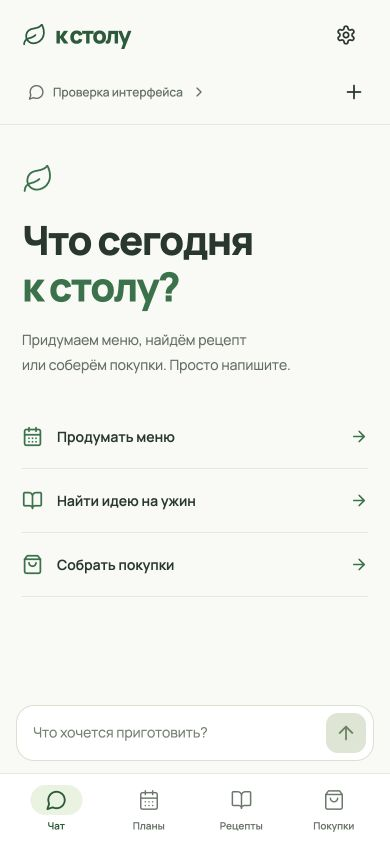
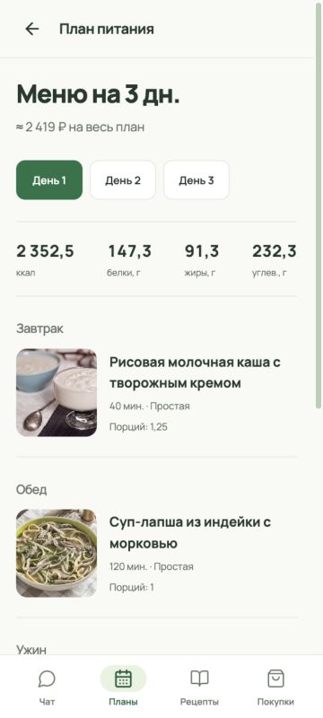

# К столу — ассистент питания

Мобильное веб-приложение для свободного разговора о питании, рецептов, меню и покупок. Один агент с инструментами; несколько чатов используют общую анкету и память. Интерфейс без рамки телефона: Чат, Планы, Рецепты, Покупки и настройки.

Реализованы React/TypeScript/Vite, FastAPI, SQLite, серверные сессии, фоновое выполнение с SSE, input guard, ручные правки без LLM и версионное сохранение. Каталоги наполняются отдельно; приложение не меняет исходные БД, автоматически готовя производный индекс RAG. [Проверки и ограничения](docs/technical/verification.md#мобильное-приложение--2026-10-19).

## Интерфейс

| Чат с ассистентом | План с фотографиями блюд |
| :---: | :---: |
|  |  |

## Запуск

Нужны uv, pnpm и git-lfs (для клона с LFS-указателями). Из корня проекта:

```bash
./run.sh
```

Скрипт загрузит LFS при необходимости, синхронизирует Python, проверит БД, соберёт frontend и запустит приложение. Первый старт также скачивает локальную модель RAG (~220 МБ) и строит индекс; следующие используют кэш вне репозитория.

Откройте [приложение](http://127.0.0.1:8080). Новый аккаунт создаётся после учётных данных и анкеты. Логин допускает один символ, пароль должен быть непустым. Тестовые аккаунты и сценарии в репозиторий не добавлены.

Поиск во вкладке «Рецепты» работает без LLM-ключа. Для чата и генерации меню скопируйте `.env.example` в `.env`, задайте `OPENROUTER_API_KEY` и перезапустите приложение; остальные настройки — [.env.example](.env.example), определения — [src/app/config.py](src/app/config.py). CLI и сервер загружают `.env` сами. По умолчанию используется `z-ai/glm-5.3-flash` через OpenInference и отдельный `openai/gpt-oss-safeguard-20b`. Без доступного guard чат останавливается с понятной ошибкой.

Один Python-процесс обслуживает API и собранный frontend. В `data/` лежат только три финальные базы:

- `recipes.sqlite` — 693 опубликованных рецепта и поиск.
- `products.sqlite` — 833 продукта (825 активных, 7 совместимых, 1 отложенный), связи с SKU, алиасы и числовые доказательства.
- `sources.sqlite` — 7492 неизменённые MCP-карточки, все 2508 исходных рецептов, реестр обработки и 6134 исходных документа.

Создание меню и его коррекция используют GPT-6 Luna `medium` через OpenRouter: настройки `PLANNING_MODEL`, `PLANNING_PROVIDER`, `PLANNING_REASONING_EFFORT`. Разговорный агент, редакторы и остальные внутренние вызовы используют GLM `low`; `MODEL` и `OPENROUTER_PROVIDER` относятся к ним. [Архитектура](docs/technical/agent-harness.md).

Приложение читает эти файлы напрямую, импорт JSON не нужен. Пользовательская БД и кэш токенизатора находятся вне репозитория: `../hse_agents_runtime/assistant.sqlite` и `../hse_agents_runtime/tokenizer`; пути настраиваются в `.env`. Перед первым запуском при отсутствии кэша загружаются только файлы токенизатора GLM (~20 МБ, без весов). Товарные операции напрямую используют публичный MCP ВкусВилла без авторизации и локального сервиса; настройка `VKUSVILL_MCP_URL`. [Подключение и ограничения](docs/technical/vkusvill.md).

Промежуточные данные, исходные tar.gz, backup и разовые скрипты подготовки перенесены в `../hse_agents_data_archive/2026-10-19/`. [Устройство баз, архив и проверка](docs/technical/data-storage.md).

```bash
uv run python -m app.catalog_check
uv run nutrition-assistant --user local --chat main
```

CLI сохраняется для локальной разработки и не использует HTTP-сессию или input guard. Его пользователь и чат задаются аргументами; интерактивный выход — `/exit` или `/quit`. Frontend dev-сервер при необходимости: `pnpm --dir frontend dev` (API проксируется на порт 8080).

## Документация

| Документ | Содержание |
|---|---|
| [Продукт](docs/design/product.md) | Пользовательские задачи и границы MVP |
| [Мобильный интерфейс](docs/design/mobile-interface.md) | Визуальная система и взаимодействия |
| [Веб-архитектура](docs/technical/web-application.md) | API, авторизация, фоновые задачи и ручные правки |
| [Агент и harness](docs/technical/agent-harness.md) | Модули, модели, история и compaction |
| [Контракты tools](docs/technical/tool-contracts.md) | 12 доменных инструментов и память |
| [Данные](docs/technical/data-model.md) | Каталог, объекты, версии и хранение |
| [Финальные БД](docs/technical/data-storage.md) | Три базы, runtime, архив подготовки и проверка |
| [Подготовка данных к RAG](docs/technical/catalog-rag-readiness.md) | Исправления, доказательства и оставшиеся пропуски |
| [Системный дизайн RAG](docs/technical/recipe-rag.md) | Рабочий гибридный поиск, контекст, отбор меню, задержки и приёмка |
| [Референсы промптов](docs/technical/references.md) | Источники и предметные адаптации |
| [Спецификация веб-приложения](docs/specs/active/mobile-web-app.md) | Критерии приёмки |
| [Проверки](docs/technical/verification.md) | Измерения, результаты и ограничения |

## Локальный RAG

Лемматизированный FTS5 и локальная многоязычная ONNX-модель работают в том же процессе. Поиск в чате и во вкладке «Рецепты» использует актуальные предпочтения/поддерживаемые ограничения и возвращает до 10 карточек с диагностикой. Генератор меню получает широкий пул, обычно 120 рецептов. Пустая разметка не подтверждает отсутствие аллергенов.

```bash
uv run meal-rag prepare
uv run meal-rag search 'ужин без духовки'
uv run meal-rag benchmark --repeats 5
```

Индекс/веса по умолчанию в `../hse_agents_runtime/retrieval*`. Настройки: `RETRIEVAL_ENABLED`, `RETRIEVAL_DENSE_ENABLED`, пути к кэшам, timeout/threads. `PLANNING_CANDIDATE_STRATEGY=full_catalog` возвращает прежнюю стратегию меню. Подробности: [архитектура](docs/technical/recipe-rag.md), [результаты](docs/technical/verification.md#реализация-и-интеграция-rag--2026-10-19).

## Проверки

```bash
uv run pytest -q
uv run ruff check src tests
uv run ruff format --check src tests
uv build
pnpm --dir frontend exec tsc -b
pnpm --dir frontend build
```

При ограничении обычного кэша uv используйте `UV_CACHE_DIR=/private/tmp/nutrition-agent-uv-cache`. Живые платные сценарии не входят в обычные тесты. Браузерная приёмка описана в отчёте; реальные интеграции отделены от контролируемых ответов.

Правила работы: [AGENTS.md](AGENTS.md), [стандарты](docs/standards/README.md), [Memory](docs/memory/). Ключи и пользовательские данные не входят в Git.
