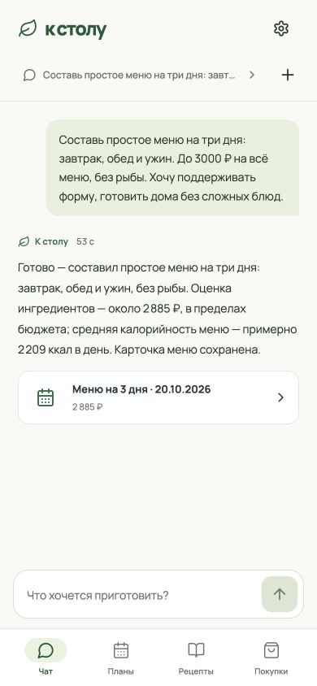
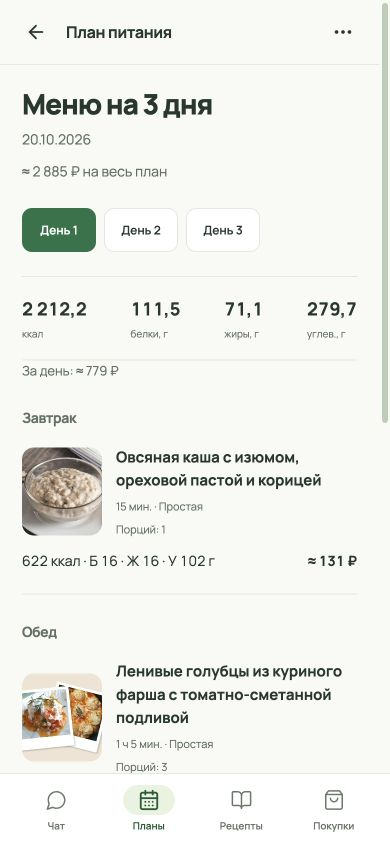
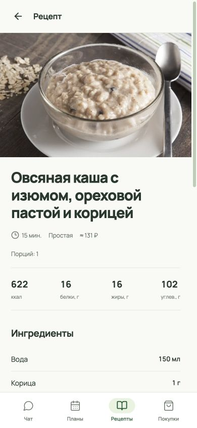
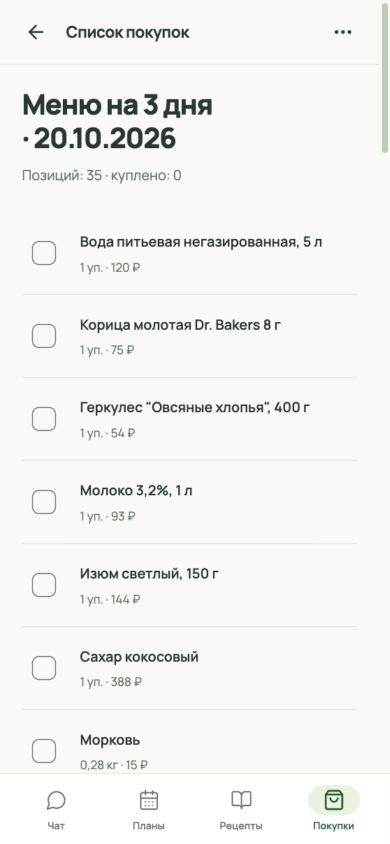
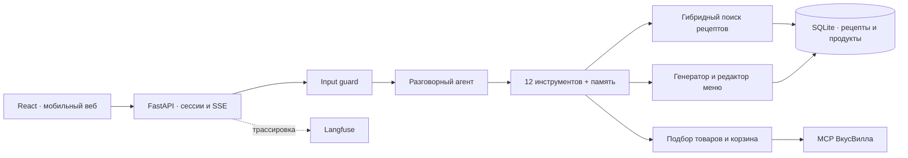

# К столу

Ассистент, который помогает решить, что приготовить, составить меню и собрать продукты для покупки. Заполните короткую анкету, напишите пожелания в чат — приложение подберёт блюда из каталога, покажет рецепты и подготовит ссылки на корзины ВкусВилла.


<table>
<tr><th>Обсудить меню</th><th>Посмотреть план</th><th>Приготовить</th><th>Купить продукты</th></tr>
<tr>
<td></td>
<td></td>
<td></td>
<td></td>
</tr>
</table>

## Команда

| Участник | GitHub |
|---|---|
| Гурьев Илья | [iagurev](https://github.com/iagurev) |
| Даутов Аскар | [97-ozzy](https://github.com/97-ozzy) |
| Евдокимов Дмитрий | [dadaevd](https://github.com/dadaevd) |
| Болдырев Александр | [boldirev-as](https://github.com/boldirev-as) |

## Что можно сделать

- Составить меню с учётом цели, анкеты, бюджета, сложности и пожеланий в разговоре. КБЖУ показываются в среднем за день и для отдельных блюд.
- Найти рецепт, посмотреть ингредиенты и шаги, выбрать блюда для покупки.
- Собрать покупки из меню, нескольких рецептов или выбранных товаров. Приложение рассчитывает нужные упаковки и показывает, что удалось подобрать.
- Изменить меню и покупки через ассистента либо вручную поправить порции и количества. Предыдущие версии сохраняются.
- Вести несколько разговоров с общей анкетой и редактируемой памятью. Выполнение продолжается при переходе между экранами; его можно остановить.

## Быстрый запуск через Docker

Нужны **Git LFS**, **Docker с Compose v2** и ключ **OpenRouter** для чата. Команды выполняются из корня клонированного репозитория:

```bash
git lfs install
git lfs pull
cp .env.example .env
```

В `.env` заполните `OPENROUTER_API_KEY`, затем:

```bash
docker compose up -d --build
docker compose logs -f app
```

Откройте **[127.0.0.1:8080](http://127.0.0.1:8080)** и создайте аккаунт. Логин — от одного символа, пароль — непустой. Аккаунт создаётся после основного шага анкеты; дополнительные сведения можно пропустить.

При первом запуске скачивается локальная модель поиска (~220 МБ) и строится индекс рецептов. Дождитесь `Application startup complete`. Проверка готовности: `curl http://127.0.0.1:8080/api/health`.

Один контейнер обслуживает API и frontend. Каталоги из `data/` подключены только для чтения; аккаунты, переписка и кэш сохраняются в Docker-томе `k-stolu_runtime`. `docker compose down` останавливает приложение, сохраняя данные. Если порт занят: `APP_PORT=8082 docker compose up -d`. Не запускайте несколько процессов приложения над одной пользовательской БД.

Без ключа доступен просмотр и поиск рецептов; чат отключён. Для моделей и MCP нужен доступ в интернет. Ключи, пользовательская БД и кэш в Git не входят. Все настройки перечислены в [.env.example](.env.example), определены в [config.py](src/app/config.py).

## Запуск для разработки

Нужны **Python 3.12+**, **uv**, **Node.js 22+**, **pnpm** и Git LFS:

```bash
./run.sh
```

Скрипт синхронизирует зависимости, проверит БД, соберёт frontend и запустит сервер на порту 8080. Локальная пользовательская БД находится в `../hse_agents_runtime/assistant.sqlite`; это отдельное хранилище от Docker-тома. Для работы над интерфейсом: `pnpm --dir frontend dev` — запросы API проксируются на 8080.

CLI для проверки агента: `uv run nutrition-assistant --user local --chat main`. Он использует тот же harness, но не проходит веб-авторизацию и input guard. Выход: `/exit`.

## Как устроен агент

**Pydantic AI управляет одним разговорным агентом.** Он выбирает инструменты, учитывает анкету, память и историю конкретного чата. Внутри создания меню и выбора товаров выполняются отдельные структурированные модельные вызовы; самостоятельных субагентов нет.



LLM нужна для понимания свободного запроса, выбора подходящих сочетаний блюд и правок по текстовому поручению. Код отвечает за идентификаторы, арифметику, агрегацию ингредиентов, упаковки, версии и сохранение. Для меню проверяются существование рецептов, числовой формат, сложность и бюджет с погрешностью 5%.

| Задача | Модель через OpenRouter | Настройка |
|---|---|---|
| Диалог, меню и сжатие истории | `openai/gpt-6-luna` | `medium` |
| Редактирование и выбор товаров | `openai/gpt-6-luna` | `low` |
| Проверка входящего сообщения | `google/gemini-2.5-flash-lite` | Один структурированный вызов |

Luna выбрана по живым сравнительным прогонам скорости и качества меню; лёгкий guard проверяется отдельно и не ограничивает разговор темой питания. [Ориентиры времени и ограничения](docs/technical/operations.md#проверки-и-границы-качества). Модели и провайдеры меняются настройками, без правки tools.

Генератор получает **весь каталог из 693 компактных карточек**. Поиск рецептов использует локальные FTS5 и многоязычные ONNX-эмбеддинги; ограничения передаются явно в `limits`. Перед каждым запросом чатового агента оценивается размер контекста: сжатие начинается от 200 тысяч токенов, предельный вход — 232 тысячи с резервом в окне 256 тысяч. Полная переписка остаётся в БД.

## Langfuse: посмотреть выполнение по этапам

Трассировка необязательна и по умолчанию выключена. Для локального Langfuse создайте проект и API-ключи, затем задайте `LANGFUSE_ENABLED=true`, `LANGFUSE_BASE_URL`, `LANGFUSE_PUBLIC_KEY` и `LANGFUSE_SECRET_KEY` в `.env`. При запуске приложения в Docker адрес сервера на хосте задаётся через `LANGFUSE_DOCKER_URL` (по умолчанию `http://host.docker.internal:3001`).

**Один trace — один пользовательский ход; session — один чат.** Внутри видны guard, запросы агента, tools, генерация/коррекция меню, поиск товаров, расчёты и создание магазинных ссылок. Ошибки и неполные результаты помечены; токены и стоимость записываются на LLM-вызовах без повторного суммирования на родителях.

[Настройка и работа с Langfuse](docs/technical/operations.md#langfuse). На локальном стенде интерфейс доступен по адресу [127.0.0.1:3001](http://127.0.0.1:3001). Это локальный адрес, а не публичное демо.

## Данные и структура проекта

Три каталога в `data/`: `recipes.sqlite` — рецепты, `products.sqlite` — нормализованные продукты и связи с магазинными товарами, `sources.sqlite` — исходные выгрузки и доказательства обработки. Приложение не наполняет их во время разговора. [Хранение и проверка данных](docs/technical/data.md).

```text
src/app/
  assistant/       агент, tools, контекст, история и Markdown-промпты
  web/             HTTP, авторизация, фоновые ходы и UI-представления
  retrieval/       локальный гибридный поиск
  planning.py      меню, редактор и расчёты
  shopping/        сценарии покупки и отдельные чистые расчёты
  integrations.py  MCP ВкусВилла
  tracing.py       Langfuse и значимые этапы выполнения
  config.py        централизованные настройки
frontend/src/
  main.tsx         оболочка, hash-навигация и сессия пользователя
  screens/         чат, коллекции, профиль и детали объектов
  components/      общие элементы, карточки и статусы ответа
  styles/          стили оболочки, форм, чата и объектов
  api.ts           HTTP-клиент, типы ответов и представление значений
  preview.ts       предварительные расчёты без запросов
data/             три каталога SQLite (Git LFS)
docs/             продукт, дизайн, краткая техническая справка и стандарты
tests/            детерминированные проверки
```

Стоимость меню приблизительна. Наличие и цены зависят от магазина. Неподобранные позиции показываются явно. Покупка более 30 разных товаров получает несколько магазинных ссылок. Приложение не оформляет и не оплачивает заказ.

## Проверки и документация

```bash
uv run pytest -q
uv run ruff check src tests
uv run ruff format --check src tests
uv build
pnpm --dir frontend exec tsc -b
pnpm --dir frontend build
node --experimental-strip-types --test frontend/test/preview.test.mjs
uv run python -m app.catalog_check
docker compose config --quiet
```

Автотесты проверяют контракты, версии, изоляцию пользователей, compaction, расчёты, ошибки и отмену. Живые прогоны моделей и браузерная приёмка выполняются отдельно и не заменяются проверкой корректного JSON.

| Документ | Для чего читать |
|---|---|
| [Продукт](docs/design/product.md) | Сценарии и границы приложения |
| [Интерфейс](docs/design/mobile-interface.md) | Визуальная система и взаимодействие |
| [Устройство приложения](docs/technical/architecture.md) | Карта кода, агент, tools, поиск, история и версии |
| [Данные](docs/technical/data.md) | Каталоги, сущности и их проверка |
| [Эксплуатация](docs/technical/operations.md) | Подключения, Langfuse и диагностика |
| [Стандарты](docs/standards/README.md) | Правила разработки |
