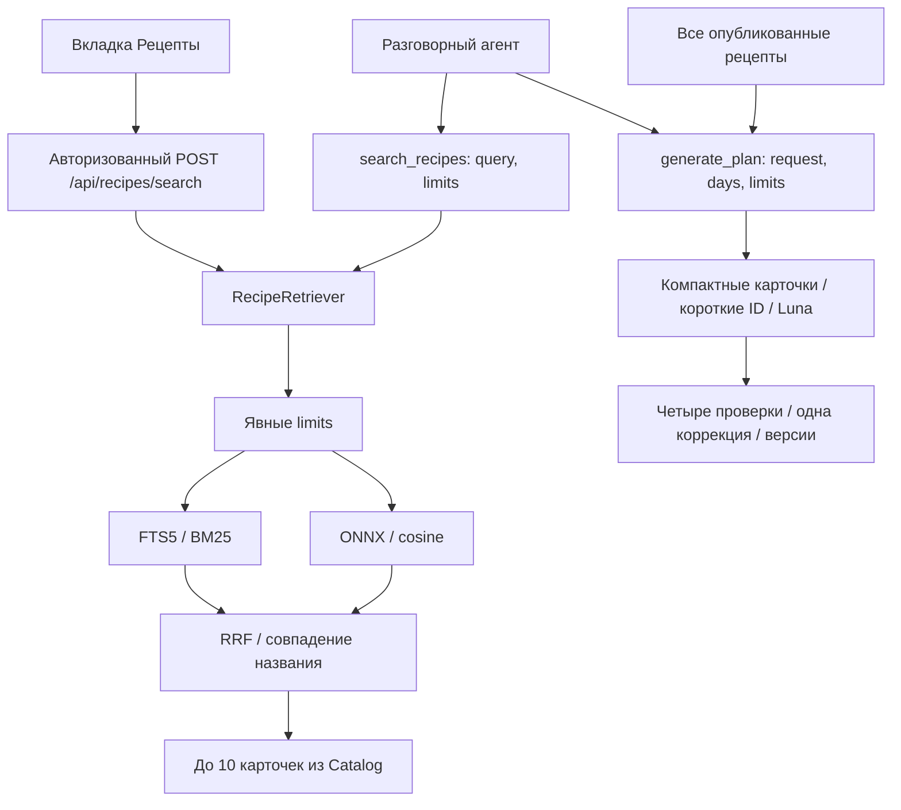

# RAG рецептов: поиск в приложении

- Status: Implemented.
- Дата согласования: 2026-10-19.
- Область: поиск по query; генерация сохраняет полный каталог. По последующему поручению пользователя парсер условий удалён; поиск принимает явные limits.
- [Спецификация](../specs/completed/recipe-rag.md), [проверки](verification.md).

## Поток данных

RecipeRetriever работает в существующем Python-процессе. Лемматизированный FTS5/BM25 и локальная многоязычная ONNX-модель объединяются через Reciprocal Rank Fusion. Дополнительных LLM-вызовов или сервисов нет. Вход — query и обязательный limits; выход — до 10 существующих коротких карточек. Диагностика остаётся в технических логах и CLI benchmark, не в публичном результате.



Session и Context получают retriever через зависимости; CLI и web готовят один экземпляр до readiness. Поиск не читает анкету, память или историю. Агент формулирует query с названием блюда/ингредиентами, отдельно передаёт ограничения в limits и оценивает карточки. Незаданные условия — null; роли приёмов пищи не выводятся автоматически из названия блюда. Planner не зависит от retriever: все 693 planning_card передаются только внутреннему генератору, короткие ID преобразуются в постоянные перед сохранением. Редактор получает текущий объект без каталога. SKU и покупки используют существующий MCP и Shopper.

## Модули

| Файл | Ответственность |
| --- | --- |
| app/retrieval/features.py | Морфология, алиасы, evidence техники и единый RecipeFilter для RAG/резервного FTS |
| app/retrieval/encoder.py | Закреплённая локальная ONNX-модель |
| app/retrieval/index.py | SHA исходников, manifest, FTS и матрица |
| app/retrieval/service.py | Вызов фильтра, гибридное ранжирование, ограниченный executor и внутренний SearchSelection |
| app/retrieval/__main__.py | Подготовка, поиск и benchmark без LLM |

Общая Pydantic-модель RecipeSearchLimits расположена в app/models.py рядом с PlanLimits/CartLimits. tools.py и HTTP используют её без копирования полей; description, вход и выход search_recipes по-прежнему собраны рядом в tools.py. Отдельный retrieval/models.py удалён; внутренней диагностике достаточно списка кодов без пользовательских фрагментов и Pydantic-иерархии.

## Документ, модель и индекс

Единица индекса — один из **693 опубликованных рецептов**. Все 2508 исходников не превращаются в готовую выдачу: 1819 needs_revision остаются вне serving. Состояние исходных данных и применённые исправления описаны в [аудите](catalog-rag-readiness.md).

Документ содержит название, все канонические имена ингредиентов и начальную часть подтверждённых шагов. Общий служебный текст адаптаций в него не включается. Для dense используются первые 600 символов метода после названия/состава; модель ограничивает вход 512 токенами. FTS индексирует название/состав/до 1600 символов шагов после лемматизации pymorphy3. Полные рецепты не обрезаются. При росте корпуса и длины ингредиентов нужно отдельно пересмотреть эту проекцию.

Рабочая модель — `sentence-transformers/paraphrase-multilingual-MiniLM-L12-v2`, quantized ONNX из qdrant, **384 измерения**, mean pooling и L2-нормализация, fastembed 0.7.4. Точная ревизия закреплена в encoder.py; это выбранный компактный baseline, а не результат большого сравнительного исследования. Исходный кандидат multilingual-e5-small не принят автоматически: использован поддерживаемый FastEmbed артефакт с проверенным локальным запуском. Веса впервые загружаются из Hugging Face в runtime-кэш, затем работают локально; проверка TLS сохранена и использует системные CA.

Для 693 × 384 float32 матрица занимает около 1 МиБ. Exact cosine достаточно для этого масштаба; HNSW не требуется. Веса encoder существенно больше матрицы и загружаются один раз.

Индекс расположен вне data: `../hse_agents_runtime/retrieval/<index_id>/`. Состав: manifest.json, documents.json с evidence, lexical.sqlite, vectors.npy без pickle. Manifest связывает индекс с SHA256 **всех трёх БД**, версией сборки, identity модели и полным упорядоченным набором ID; у производных файлов есть собственные SHA. Один release_id недостаточен: прежнее округление уже меняло файл внутри базового выпуска.

При старте проверяются hashes, SQLite integrity, ID, размерность и конечность векторов. Устаревший/повреждённый индекс пересобирается в отдельной директории и публикуется до readiness. Модель/индекс не скачиваются в пользовательском запросе. Если модель или её индексация недоступны, готовится отдельный lexical-индекс с той же фильтрацией. Каталог при старте валидируется; LFS pointer даёт ясную ошибку о git lfs pull.

Горячая замена каталога не поддерживается: обновлять три БД надо согласованным выпуском с перезапуском процесса. Изменение inode/mtime/размера после старта прекращает выдачу старого индекса с диагностикой. Это эксплуатационная защита; произвольный конкурентный внешний writer не входит в поддерживаемый режим.

## Явные ограничения

`search_recipes(query, limits)` и HTTP принимают одну схему. Все семь полей обязательны и допускают null:

| Поле | Смысл |
| --- | --- |
| exclude_products | Исключить нормализованные продукты по имени/алиасу или product_id |
| forbidden_equipment | Исключить рецепты с недоступной техникой |
| max_total_minutes | Верхний предел общего времени приготовления |
| max_difficulty | easy / intermediate / advanced, не выше указанной сложности |
| meal_roles | Хотя бы одна из явно запрошенных ролей breakfast/lunch/dinner/snack/dessert |
| diet | vegetarian / vegan: исключение известных животных ингредиентов |
| budget_rub | Бюджет одной базовой порции; средняя цена не выше 105% переданного значения |

Незаданные условия агент передаёт как null; пустые списки также ничего не исключают. Нулевой бюджет допустим и не отключает фильтр. Числа конечные; строки, bool, отрицательный бюджет и неположительное время отклоняются схемой. Отсутствующий limits или неполный объект — ошибка валидации, не запрос на наследование анкеты.

Парсера отрицаний, времени, ролей и диет из query нет. Названия продуктов из **отдельного поля** разрешаются через справочник, алиасы и леммы; оборудование — через известные названия. Неизвестное исключение не игнорируется, а оставляет пустую выдачу с внутренним UNRESOLVED_CONSTRAINT. Запрос и персональные данные не сохраняются в общем кэше.

Оборудование извлекается из шагов при подготовке индекса: альтернативы внутри группы OR, группы между собой AND. «Духовка или аэрогриль» допускает аэрогриль при запрете духовки; готовая курица гриль не требует гриля. Неустановленный нагрев консервативно исключается при запрете техники. У 114 рецептов equipment пуст, это не доказательство отсутствия устройств.

Фильтры состава работают по текущим общим ингредиентам и группам, а не по полной разметке аллергенов/диет. Вегетарианская/веганская классификация остаётся неполной; обобщённые ингредиенты и пустой restrictions не подтверждают безопасность. Соответствие свободнотекстовым особенностям дополнительно оценивает агент. Пустая выдача означает отсутствие найденных кандидатов в базе.

## Ранжирование и пределы

Условия применяются до top-k. BM25 использует веса названия/состава/метода 5/2/0.3; dense — cosine с исходным порогом 0.45. Каждая ветка возвращает до 60 допустимых ID; RRF использует sum(1/(60+rank)) и бонус совпадения названия. Для явно названного блюда проверяется основное название: «яблоки к сырникам» не подменяют сырники. Запрос аналога допускает более широкую выдачу. Финальные 10 карточек читаются из Catalog пакетно, без генерации фактов.

Это воспроизводимый baseline, не доказанный оптимум. Большой размеченный holdout, nDCG/MRR и сравнение encoder ещё не проведены. Полный план не ограничивается этими кандидатами; предварительного RAG-отбора для меню нет.

## API, UI и запуск

- search_recipes(query, limits) и POST /api/recipes/search возвращают только data.recipes; внешний формат Result сохранён.
- generate_plan(request, days, limits) сохраняет прежние явные limits и полный каталог.
- В «Рецептах» введённый query ищет глобально; пустая строка показывает «Из ваших планов». Вкладка явно передаёт все поля limits=null, фильтры доступны через чат. Placeholder — «Название блюда или ингредиенты». Debounce 350 мс, устаревший ответ не заменяет новый; карточка открывает полный рецепт.
- /api/health показывает retrieval/dense/index_id и chat_enabled.
- Без OpenRouter-ключа локальный поиск и просмотр доступны; чат возвращает 503 до создания фонового хода.

./run.sh проверяет LFS, синхронизирует зависимости из публичного PyPI, проверяет каталог, собирает frontend и запускает приложение. Нужны uv, pnpm и Git LFS для клона с указателями. Первая загрузка весов требует сети; модель и индекс не скачиваются внутри запроса.

```bash
uv run meal-rag prepare
uv run meal-rag search 'омлет'
uv run meal-rag search 'омлет' --limits '{"exclude_products":null,"forbidden_equipment":["духовка"],"max_total_minutes":30,"max_difficulty":"easy","meal_roles":null,"diet":null,"budget_rub":150}'
uv run meal-rag --lexical search 'омлет'
uv run meal-rag benchmark --repeats 5
```

Настройки в Config/.env.example: RETRIEVAL_ENABLED, RETRIEVAL_DENSE_ENABLED, пути к кэшам, timeout и threads. Отключение RAG оставляет Catalog FTS с тем же RecipeFilter до top-10; отключение dense сохраняет лемматизированный поиск и явные limits. CLI без --limits явно передаёт все null. Настроек стратегии отбора меню нет.

## Отказы и наблюдаемость

Inference выполняется в одном executor worker с одним ожидающим запросом и общим deadline 2.8 с. При timeout/отмене начатая CPU-задача удерживает слот до фактического завершения. Отказ dense даёт лексические кандидаты с теми же условиями; диагностика не расширяет контракт tools. Логи содержат index_id, коды диагностики, размеры и время, без query, анкеты и памяти.

Цель 2–3 секунды относится к локальному поиску, не ко всему ходу LLM. [Исторические измерения](evidence/recipe-rag-benchmark.json) и [эксперимент отбора меню](evidence/recipe-rag-plan-selection.json) сохранены как свидетельства исходной версии; отбор меню не подключён к текущему приложению. Актуальная приёмка объединения — в [verification](verification.md). Дальнейшие улучшения требуют независимой проверки релевантности; отдельный векторный сервис или HNSW сейчас не нужны.
