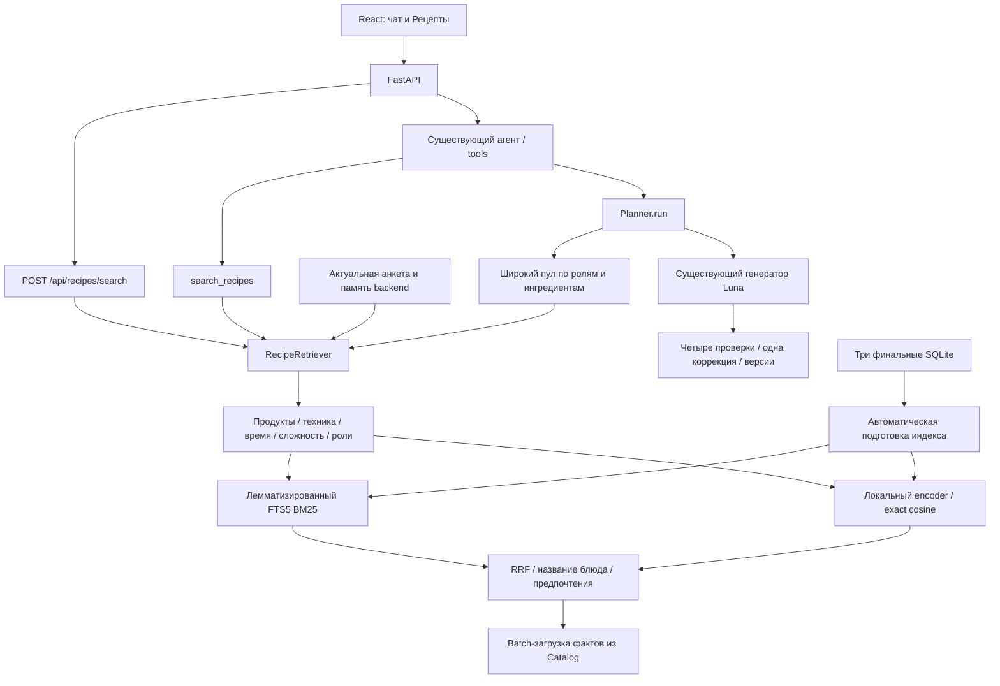

# RAG рецептов: архитектура и рабочая интеграция

- Status: Implemented — runtime, индекс, поиск и подключение к Planner реализованы.
- Дата: 2026-10-19.
- Авторизация: пользователь поручил полную реализацию и интеграцию подготовленного дизайна с простым запуском.
- Приёмка: [спецификация](../specs/completed/recipe-rag.md), [проверки](verification.md#реализация-и-интеграция-rag--2026-10-19).

## Задача и решение

Вход — блюдо/ингредиенты, поддерживаемые условия и актуальный PersonContext. Выход — до десяти существующих карточек с diagnostics. Для меню используется отдельный широкий пул, обычно 120 кандидатов, с покрытием ролей и разнообразием. Цель 2–3 секунды относится к поиску, а не к ответу разговорной LLM или генерации меню.

RecipeRetriever работает внутри существующего Python-процесса. Лексический FTS5 и локальная многоязычная ONNX-модель объединяются через Reciprocal Rank Fusion. Отдельный агент, сетевой векторный сервис или дополнительный LLM-вызов не нужны. Три исходные БД остаются read-only. RAG включён по умолчанию; у генератора сохранён режим full_catalog для отката.

## Интеграция



Session получает retriever явной зависимостью; Context передаёт его tool. CLI и web создают один общий модуль до готовности приложения. Поисковый tool читает свежую память из Store; Planner получает переданный персональный контекст и сам отбирает кандидатов, без обязательного предварительного search_recipes. `Catalog.get` теперь читает только выбранные ID.

На прежней архитектурной схеме это заменяет часть поиска блюд. Live SKU, фасовки и ссылка корзины по-прежнему принадлежат Shopper и MCP ВкусВилла. Старые обязательные approve-кнопки и отдельный Validation LLM не добавляются.

## Модули

| Файл | Ответственность |
| --- | --- |
| app/retrieval/models.py | SearchConstraints, независимая диагностика и внутренний Selection |
| app/retrieval/features.py | Русская морфология, продуктовые алиасы, отрицания, предпочтения и evidence техники |
| app/retrieval/encoder.py | Закреплённая многоязычная модель, локальный CPU inference |
| app/retrieval/index.py | SHA исходников, manifest, FTS, документы и матрица |
| app/retrieval/service.py | Фильтрация, гибридный поиск, широкий пул и ограниченный executor |
| app/retrieval/__main__.py | Подготовка, поиск и benchmark без LLM-ключа |

## Документ, модель и индекс

Единица индекса — один из **693 опубликованных рецептов**. Все 2508 исходников не превращаются в готовую выдачу: 1819 needs_revision остаются вне serving. Состояние исходных данных и применённые исправления описаны в [аудите](catalog-rag-readiness.md).

Документ содержит название, все канонические имена ингредиентов и начальную часть подтверждённых шагов. Общий служебный текст адаптаций в него не включается. Для dense используются первые 600 символов метода после названия/состава; модель ограничивает вход 512 токенами. FTS индексирует название/состав/до 1600 символов шагов после лемматизации pymorphy3. Полные рецепты не обрезаются. При росте корпуса и длины ингредиентов нужно отдельно пересмотреть эту проекцию.

Рабочая модель — `sentence-transformers/paraphrase-multilingual-MiniLM-L12-v2`, quantized ONNX из qdrant, **384 измерения**, mean pooling и L2-нормализация, fastembed 0.7.4. Точная ревизия закреплена в encoder.py; это выбранный компактный baseline, а не результат большого сравнительного исследования. Исходный кандидат multilingual-e5-small не принят автоматически: использован поддерживаемый FastEmbed артефакт с проверенным локальным запуском. Веса впервые загружаются из Hugging Face в runtime-кэш, затем работают локально; проверка TLS сохранена и использует системные CA.

Для 693 × 384 float32 матрица занимает около 1 МиБ. Exact cosine достаточно для этого масштаба; HNSW не требуется. Веса encoder существенно больше матрицы и загружаются один раз.

Индекс расположен вне data: `../hse_agents_runtime/retrieval/<index_id>/`. Состав: manifest.json, documents.json с evidence, lexical.sqlite, vectors.npy без pickle. Manifest связывает индекс с SHA256 **всех трёх БД**, версией сборки, identity модели и полным упорядоченным набором ID; у производных файлов есть собственные SHA. Один release_id недостаточен: прежнее округление уже меняло файл внутри базового выпуска.

При старте проверяются hashes, SQLite integrity, ID, размерность и конечность векторов. Устаревший/повреждённый индекс пересобирается в отдельной директории и публикуется до readiness. Модель/индекс не скачиваются в пользовательском запросе. Если модель или её индексация недоступны, готовится отдельный lexical-индекс с той же фильтрацией. Каталог при старте валидируется; LFS pointer даёт ясную ошибку о git lfs pull.

Горячая замена каталога не поддерживается: обновлять три БД надо согласованным выпуском с перезапуском процесса. Изменение inode/mtime/размера после старта прекращает выдачу старого индекса с диагностикой. Это эксплуатационная защита; произвольный конкурентный внешний writer не входит в поддерживаемый режим.

## Условия и персональный контекст

SearchConstraints содержит exclude_products, forbidden_equipment, max_total_minutes, max_difficulty, meal_roles, diet и allergens. Поля nullable/необязательные, размера выдачи среди них нет. Имена исключений разрешаются через канонические продукты, алиасы, русские леммы и небольшой явный словарь групп. Например, творога → творог, курица → куриные продукты. Произвольное сходство векторов не делает продукты взаимозаменяемыми.

Высокоточный ограниченный разбор поддерживает «без», «не ем», «не употребляю», «исключить», отсутствие известных устройств, целые минуты и названные роли. Непонятое отрицание приводит к diagnostics и отсутствию подтверждённой выдачи. Оно не становится положительным термом MATCH. Сложная свободная семантика остаётся задачей разговорного агента; он передаёт действующие структурированные условия в обычном tool-вызове, дополнительной модели-парсера нет.

Порядок: актуальные анкета/память → явно переданные поля constraints → отрицания и поддерживаемые условия текущего query. Явный пустой список снимает прежний запрет для этой задачи. Непереданные поля сохраняют baseline. Явный null снимает предел сложности поиска. Для генерации меню limits остаются авторитетным числовым контрактом; RAG не восстанавливает снятый предел из анкеты. Бюджет не выводится и не увеличивается поиском.

Постоянные ограничения не извлекаются из старого dialogue. Любимые продукты из текущей памяти («люблю», «предпочитаю», «нравится») мягко влияют на поиск; после очистки памяти этот сигнал исчезает. Все неизвестные предпочтения также остаются контекстом существующей LLM. Персональные запросы/выдача/embeddings не сохраняются в общем кэше и не включаются в каталог. Модель для embedding работает локально.

## Оборудование и неизвестность

Из реальных шагов извлекаются обязательные группы с цитатой и номером шага. Внутри группы устройства альтернативны (OR), между группами обязательны (AND). «Духовка или аэрогриль» допускает аэрогриль при запрете духовки. Готовая курица гриль не требует гриля. Упоминания хранения/заготовки не превращаются автоматически в обязательную технику. Отдельно отмечается нагрев с неизвестным устройством: такие карточки консервативно исключаются при ограничении техники.

Эта эвристика не является полным кулинарным парсером: сложные предложения, режимы устройств и optional-фрагменты требуют дальнейшей разметки. У 114 исходных equipment пусто; это не доказательство отсутствия техники.

Пустой restrictions, обобщённая «зелень» и усреднённые продукты не сертифицируют отсутствие аллергенов. При явном требовании подтверждённой аллергенной безопасности (allergens или сообщение об аллергии/непереносимости) система возвращает недостаток доказательств. Vegetarian/vegan исключают известные животные ингредиенты и предупреждают о неподтверждённом составе сложных товаров; они не являются медицинской гарантией. «Здоровый» не задаёт выдуманную норму КБЖУ.

## Ранжирование

1. Условия применяются до top-k. FTS рассматривает все совпадения, затем берёт top 60 допустимых ID; dense сравнивает все допустимые векторы.
2. Лексическая ветка использует BM25 с весами названия/состава/метода 5/2/0.3. Семантическая — cosine, стартовый порог 0.45.
3. Списки объединяются через RRF `sum(1/(60+rank))`, с небольшими бонусами совпадения названия. Предпочтения дают мягкий сигнал.
4. Для явно названного типа блюда (омлет, сырники, суп и др.) проверяется соответствие основного названия. Подача «яблоки к сырникам» не подменяет сырники, если подходящих сырников нет. Запросы похожего/аналога допускают более широкую выдачу.
5. Возвращается до 10 ID; карточки загружаются batch из Catalog. ID, числа, названия, фото и количества не генерируются моделью.

Порог и коэффициенты — воспроизводимые исходные настройки. Большой размеченный holdout, nDCG/MRR и сравнение encoder/reranker пока не проведены. Низкая задержка сама по себе не доказывает релевантность всех запросов.

## Меню

При strategy=retrieval Planner получает широкий пул: релевантные варианты каждой запрошенной роли, дешёвые и быстрые альтернативы, затем пополнение через ингредиентные группы. Базовый размер — 120; число дней может увеличить его. Если роли не заданы, покрываются существующие роли как ассортимент; число приёмов пользователю не назначается. Недостаток покрытия расширяет пул до всего допустимого каталога **до** первого вызова генератора. Жёсткие условия не снимаются.

Generator получает обычные planning_card, retrieval_constraints и диагностику. Существующие расчёты, проверка ID/чисел/сложности/бюджета, одна коррекция и сохранение версий остаются у Planner. Пустой подтверждённый пул даёт NO_SUITABLE_RECIPES без вызова модели. После неудачной генерации автоматического полного перезапуска нет. Редактор сохраняет прежнюю схему полной версии и незатронутые блюда; новый retrieval-пул не ограничивает чтение истории.

`PLANNING_CANDIDATE_STRATEGY=full_catalog` возвращает прежнюю стратегию. `RETRIEVAL_ENABLED=false` полностью отключает RAG, оставляя старый FTS; `RETRIEVAL_DENSE_ENABLED=false` сохраняет новый лексический поиск и условия с явной диагностикой отключённой dense-ветки.

## API, UI и запуск

- `search_recipes(query, constraints?)` — карточки и data.diagnostics с независимыми поисковыми кодами; IssueCode меню не расширен.
- `generate_plan(request, days, limits, constraints?)` — самостоятельный отбор широкого пула.
- POST `/api/recipes/search` — тот же поиск с авторизацией и актуальным профилем backend.
- В «Рецептах» пустой поиск показывает рецепты планов, введённый запрос ищет по всему каталогу. Debounce 350 мс, устаревший ответ не затирает новый запрос; карточка открывает полный рецепт.
- GET `/api/health` показывает готовность retrieval/dense/index_id и chat_enabled.
- Без OpenRouter-ключа приложение запускается с локальным поиском и просмотром. Чат возвращает явный HTTP 503 до создания фонового хода; ключ необходим для LLM-диалогов и меню. Заглушки вместо production LLM не используются.

Из корня: `./run.sh` проверяет LFS, синхронизирует Python, проверяет каталог, собирает frontend и запускает приложение. Предпосылки: uv, pnpm, Git LFS для клона с указателями. Первая загрузка модели требует сети и занимает заметно больше тёплого поиска. Для полного чата заполните OPENROUTER_API_KEY в .env и перезапустите.

```bash
uv run meal-rag prepare
uv run meal-rag search 'ужин без духовки'
uv run meal-rag --lexical search 'омлет'
uv run meal-rag benchmark --repeats 5
```

Все параметры находятся в Config/.env.example. Веса и индекс по умолчанию лежат рядом с репозиторием в hse_agents_runtime; в data по-прежнему ровно три финальные БД.

## Задержка, отказы и наблюдаемость

Тяжёлый inference выполняется в одном executor worker. Допускается один ожидающий запрос, очередь ограничена deadline. При timeout/отмене уже начатая CPU-задача удерживает слот до фактического завершения; отмена coroutine не считается остановкой потока. Переполнение/ошибка encoder даёт лексическую выдачу с сохранением условий и diagnostics. Пустой положительный текст не объявляется отказом encoder.

Логи Loguru содержат index_id, назначение, число допустимых/отобранных кандидатов, время и тип отказа. Сырой query, профиль и память в них не записываются. Исходный лимит retrieval — 2.8 с; длинная работа локального encoder не продолжает занимать новые неограниченные слоты. Время чата/генератора измеряется отдельно.

Реальные локальные измерения и 30 задач отбора: [benchmark](evidence/recipe-rag-benchmark.json), [пулы меню](evidence/recipe-rag-plan-selection.json). Они проверяют runtime и размер входа, но не заменяют независимую оценку качества меню живой Luna. [Полная проверка и ограничения](verification.md#реализация-и-интеграция-rag--2026-10-19).

## Дальнейшие улучшения

Следующий этап качества — независимый русский gold set, сравнение embeddings, настройка порога и оценка меню на разнообразных профилях. Более строгая диетическая безопасность требует подтверждённой разметки состава, не только нового ранжировщика. Перенос в PostgreSQL может сохранить контракт RecipeRetriever, ID и доказательства: tsvector/trigram для слов, pgvector для cosine. На текущем масштабе он не нужен и не выполнялся. HNSW, cross-encoder и отдельный сервис стоит добавлять после измеренного выигрыша.
